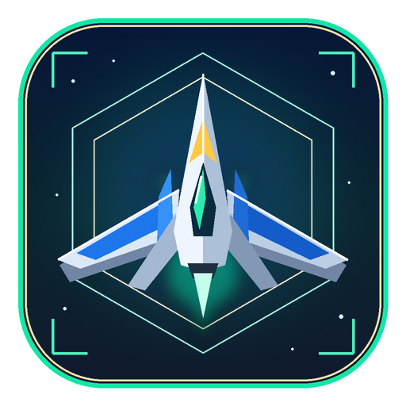
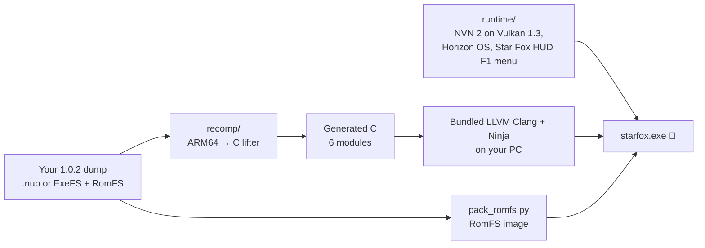

<div align="center">



# 🦊 SteelTemple Star Fox

### Star Fox, running natively on Windows PC

*A static recompilation of the Nintendo Switch 2 game, not an emulator.*

[](#-requirements)
[](#-under-the-hood)
[](#-quick-start)
[](https://github.com/STS78721/SUNHOUND/releases/tag/0.1.0)
[](#-credits--licence)

**[Quick start](#-quick-start)** · **[Features](#-highlights)** · **[Status](#-status-010-early-release)** · **[How it works](#-under-the-hood)** · **[Changelog](CHANGELOG.md)** · **[Credits](#-credits--licence)**

</div>

---

> [!WARNING]
> **Early Release (`0.1.0`):** *Star Fox* is booting and playable at a locked **60 FPS** up to native **4K** right now, but this is an **early release** — you may still encounter occasional rendering quirks, first-seen shader translation stutters, or performance differences across GPU/CPU configurations. Updates will continue to polish visuals, stability, and frame rate.

> [!IMPORTANT]
> **No game files are included.** You need your own legally dumped copy of **Star Fox (1.0.2)** (either a `.nup` container or `ExeFS` and `RomFS` dump folders). This repository contains only the recompiler, runtime, launcher, and setup tools.

> [!NOTE]
> **Clean Zero-Config Defaults:** SteelTemple Star Fox launches on a safe, hardware-agnostic baseline (`1920x1080` windowed, Original internal resolution, Star Fox HUD `F1` menu, `16x` anisotropic filtering, SMAA 1x Off, AMD FSR, Frame Generation Off, `60 FPS` limit) with no personal `.ini` settings bundled. Adjust resolution up to native `4K (2160p)`, SMAA 1x, fullscreen, upscaling, and controls anytime in **StarFoxLauncher** or in-game (`F1`).

## ✨ Highlights

<table>
<tr>
<td width="50%" valign="top">

### 🚀 Native Windows PC binary, not emulation
Every ARM64 instruction across `main`, `subsdk0`, `subsdk1`, `subsdk2`, `subsdk3`, and `sdk` is translated **ahead of time** into C and compiled natively on your PC into `starfox.exe`. No CPU interpreter runs while you play.

### 🖼️ Native 720p–4K rendering & live SMAA 1x
Switch cleanly between **Original**, **720p**, **900p**, **1080p**, **1440p**, and **native 4K (2160p)** internal 3D resolutions with borderless fullscreen (`F11` or `F1` menu), live **SMAA 1x** morphological anti-aliasing, AMD FSR 1.0, and colour presets.

### ⚡ Vulkan 1.3 renderer, full shadows & locked 60 FPS
Translates Switch 2 NVN 2 commands and Ampere (`SM86`) shaders onto **Vulkan 1.3** with full separate-texture/sampler and shadow-map lighting parity, Graphics Pipeline Libraries, and zero-overhead native execution for locked 60 FPS flight action.

</td>
<td width="50%" valign="top">

### 🎯 Star Fox HUD F1 menu
Press **F1** or **Esc** (or **Back + Y** on a controller) for a native settings overlay in the custom **Star Fox HUD** theme (plus Dark and Light themes) with a live FPS / frametime pill (`F10`) and automatic saving to `starfox.ini`.

### 🖥️ Setup Wizard & StarFoxLauncher (.nup & direct dumps)
Install cleanly with **`SteelTemple-StarFox-0.1.0-Full-Setup-Wizard.exe`** or the portable archive: bundled LLVM-MinGW, Ninja, and Python verify all 8 **1.0.2** ExeFS hashes from your `.nup` container or `ExeFS`/`RomFS` folders and build `starfox.exe` locally with no external tools required.

### 🎮 Controllers, mods & local save backups
Supports Xbox, DualSense, Nintendo Switch / Switch 2 Pro controllers, and keyboard/mouse out of the box. Includes quick folder access and timestamped save snapshots inside **StarFoxLauncher**.

</td>
</tr>
</table>

## 📊 Status (`0.1.0` Early Release)

| Area | State |
|---|---|
| Boot, title, cutscenes & menus | ✅ Working |
| 3D flight gameplay & lighting/shadows | ✅ Playable (locked 60 fps target) |
| Native internal resolution (`original` – `2160p` 4K) & SMAA 1x | ✅ Working |
| Audio, saves & controller input | ✅ Working |
| Later missions, edge-case visuals & performance across GPUs | ⚠️ Early release — rendering and performance quirks may still occur |
| Online play | ❌ Not supported, by design |

## 🚀 Quick start

**1. Install SteelTemple Star Fox**

Download **`0.1.0`** from the **[Releases page](https://github.com/STS78721/SUNHOUND/releases/tag/0.1.0)**:
- Run **`SteelTemple-StarFox-0.1.0-Full-Setup-Wizard.exe`** (no administrator rights required), or extract **`SteelTemple-StarFox-0.1.0-Portable-StandAlone.zip`**.

**2. Set up from your Star Fox 1.0.2 dump**

Open **StarFoxLauncher** → **SETUP FROM DUMP**, then choose one of:
- a **`.nup`** container (combined, or split base + `1.0.2` update in the same folder),
- a dump / NUP-extracted folder (flat `ExeFS` + `RomFS`, or `updates\<ver>\exefs`), or
- your **`ExeFS`** and **`RomFS`** folders directly.

Click **VERIFY & BUILD STARFOX.EXE**. Setup verifies all 8 `1.0.2` ExeFS SHA-256 hashes, packs RomFS, lifts all 6 ARM64 modules to C, compiles `starfox.exe` natively, and runs a short muted shader pre-warm pass.

**3. Play:** click **PLAY STAR FOX PC** (or run `starfox.exe`).

<details>
<summary>Building from source (developers)</summary>

```bat
python tools\check_content.py
.venv\Scripts\python.exe recomp\gen.py --exefs "<dump>\exefs" --out generated\starfox102 --patches recomp\patches-starfox102.txt --modules main,subsdk0,subsdk1,subsdk2,subsdk3,sdk
.venv\Scripts\python.exe tools\pack_romfs.py --dir "<dump>\romfs" --out romfs_packed
.venv\Scripts\python.exe tools\build_game.py --version starfox102 --expected tools\data\expected-starfox102.json --gen generated\starfox102 --exefs "<dump>\exefs" --romfs romfs_packed
.venv\Scripts\python.exe tools\build_starfox_release.py
```

</details>

## 🖥️ Requirements

| | Minimum | Recommended |
|---|---|---|
| OS | Windows 10 64-bit | Windows 11 |
| CPU | x86-64 with AVX2 | 8 cores or more |
| GPU | Vulkan 1.3, 6 GB VRAM | NVIDIA RTX 30/40/50 or AMD RX 6000/7000, 8+ GB VRAM |
| RAM | 16 GB | 32 GB |
| Disk | ~25 GB free during setup | NVMe SSD |

## ⚙️ Settings

Press **F1** / **Esc** in game or configure before launch inside **StarFoxLauncher**. Settings save cleanly to `starfox.ini` next to `starfox.exe`, and any option can also be overridden with `STARFOX_` / `NS2_` environment variables.

## 🔧 Under the hood



- **CPU:** *Star Fox*'s six ARM64 modules (`main`, `subsdk0`, `subsdk1`, `subsdk2`, `subsdk3`, `sdk`) are statically lifted to C ([`recomp/`](recomp/)); [`runtime/`](runtime/) supplies the Horizon OS kernel, asynchronous preemption, dynamic memory management, audio, controller input, and the Star Fox HUD settings overlay.
- **GPU:** Switch 2 NVN 2 commands translate onto **Vulkan 1.3** with Graphics Pipeline Libraries, Ampere (`SM86`) shader lowering, full `c[2]` and compute `c[0]` separate texture/sampler binding support, live 3-pass compute **SMAA 1x**, AMD FSR 1.0, and frame pacing.
- **Release Versioning:** [`VERSION`](VERSION) / [`launcher/starfox_version.txt`](launcher/starfox_version.txt) drive the version label across the Setup Wizard, `StarFoxLauncher`, Windows Installed Apps, window title, `F1` menu, and `starfox.exe`, alongside [`CHANGELOG.md`](CHANGELOG.md).

## 🙏 Credits & licence

Built with **Eglantine** (Ampere SM86 shader lowering), **Ryujinx**, **SDL3**, **Dear ImGui**, **Vulkan Memory Allocator (VMA)**, **libopus**, **libvpx**, **dav1d**, **zstd**, **SMAA**, and **FidelityFX FSR**.

Licensed under the **GNU GPL v3 or later** (see [`LICENSE`](LICENSE)); permissive and third-party notices are preserved in [`THIRD_PARTY_NOTICES.md`](THIRD_PARTY_NOTICES.md).

---

<div align="center">

<sub>Star Fox is a trademark of Nintendo. This is an unofficial non-commercial fan research project, not affiliated with or endorsed by Nintendo. Please support the official release.</sub>

</div>
